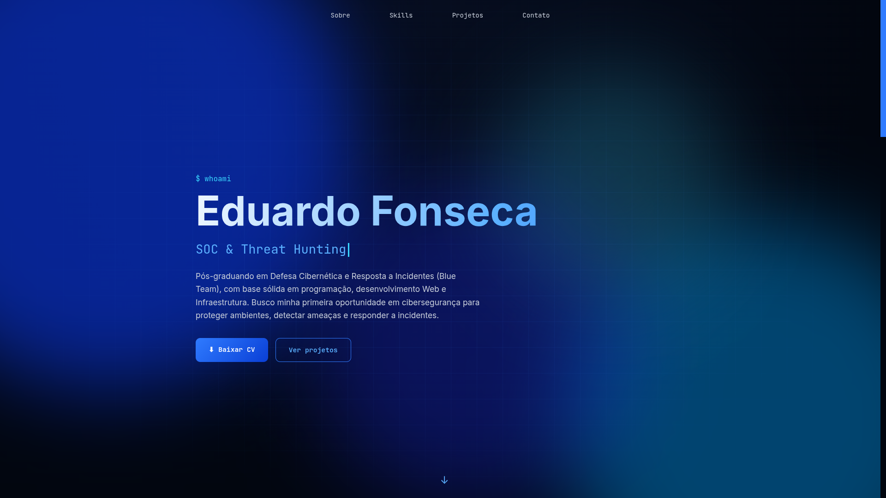

# Portfólio | Cibersegurança

Link: (Ainda vou inserir)

## Sobre mim

Sou Pós-graduando em Defesa Cibernética pela UFPE (CEIC), onde aprendo e crio projetos práticos sobre aspectos de segurança defensiva, criação de antivírus baseado em I.A, operações SOC, CTI e Threat Hunting, OSINT, segurança aplicada a redes de computadores, segurança de perímetro e Firewalls, entre outros.
 
Graduado em Sistemas para Internet (UNICAP), onde aprendi e realizei diversos projetos, individuais ou em grupo, sobre desenvolvimento Web e Mobile, linguagens de programação como Java, JavaScript, TypeScript e Python, banco de dados, I.A e Machine Learning, entre outros conceitos da área de desenvolvimento.
 
Formação técnica em Manutenção e Suporte em Informática e mais de um ano de experiência profissional em suporte técnico ao usuário. Tenho conhecimento em manutenção de computadores e periféricos, identificação e resolução de problemas em computadores, suporte ao usuário (helpdesk), cabeamento de redes, sistemas operacionais e instalação e configuração de impressoras.

## Sobre o portfólio

Site de página única, escuro e responsivo, criado para reunir minha formação, minhas habilidades e os projetos de segurança que desenvolvo. A identidade visual segue a temática de cibersegurança, com paleta em preto, azul e branco.

### Destaques

- Texto de apresentação com efeito de digitação
- Fundo animado com luzes em movimento e uma grade que se desloca lentamente
- Cards de projeto com inclinação 3D e brilho que acompanham o mouse
- Animações de entrada ao rolar a página
- Suporte a `prefers-reduced-motion`, que reduz as animações para quem prefere assim

### Tecnologias

## Projetos em destaque

- **[Analisador de Logs (SIEM Caseiro)](https://github.com/jfonsecaedu/siem.tool)**: detecção de brute force em logs de autenticação com Python e regex.
- **[Classificador com SVM (Amadey)](https://github.com/jfonsecaedu/classificador-svm-amadey)**: classificador de malware com machine learning, treinado a partir de análise estática.

## Contato

- LinkedIn: [eduardoj-fonseca](https://www.linkedin.com/in/eduardoj-fonseca)
- E-mail: jfonsecaedu@gmail.com
